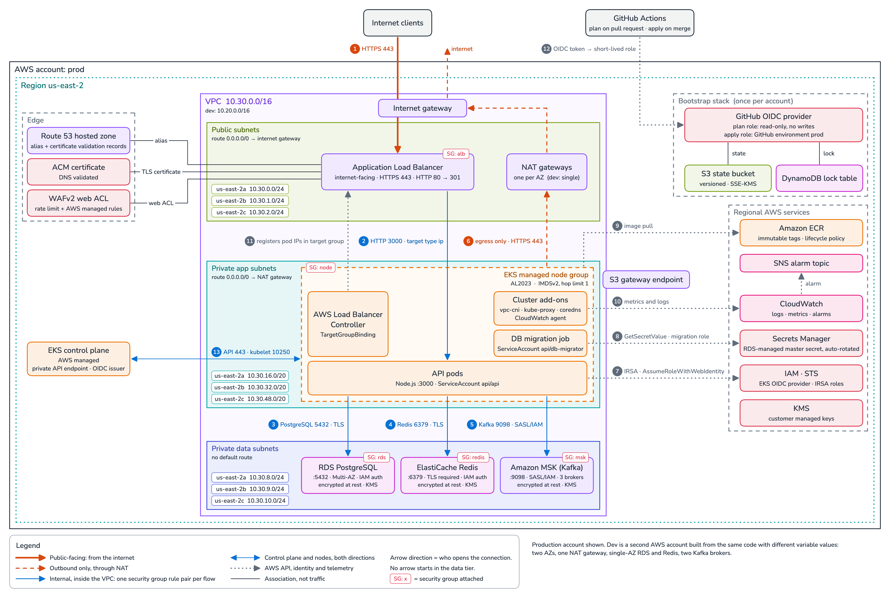

# AWS Platform Infrastructure

Production-oriented AWS infrastructure for a containerised backend service, written in
Terraform: EKS, PostgreSQL, Redis, Kafka and the network, identity and delivery
pipeline around them.



## What this is

A case study in provisioning the infrastructure one backend microservice needs to run
in production. The service is a Node.js API that serves HTTPS traffic from the
internet, stores data in PostgreSQL, caches in Redis and exchanges events over Kafka.

The full plan is in [`docs/architecture.md`](docs/architecture.md): traffic flows,
network layout, security group matrix, identity model, state strategy and the
assumptions that only an apply would confirm.

## Key decisions

Each one has a decision record in [`docs/adr/`](docs/adr/README.md) with the
alternatives that were considered and what the choice costs.

1. **No secret in code or state.** The only password in the system, the PostgreSQL
   master user's, is generated, stored in Secrets Manager and rotated by RDS; Terraform
   holds its ARN, and only the migration job's role may read it. The API signs in to
   PostgreSQL, Redis and Kafka with short-lived IAM tokens, through an IRSA role for its
   service account, and the pipeline assumes its roles through GitHub OIDC.
   ([ADR 2](docs/adr/0002-iam-authentication-for-data-stores.md))
2. **One AWS account per environment, environments as data.** `dev` and `prod` are the
   same root module with different variable files. Each runs in its own account, with
   its own state bucket, lock table and CI roles created by a bootstrap stack, and the
   provider refuses credentials for any other account.
   ([ADR 1](docs/adr/0001-one-account-per-environment.md))
3. **Terraform stops at the AWS API.** One provider and no third-party modules.
   Terraform owns everything public, from the certificate to the WAF, and never calls
   Kubernetes: the cluster's API is private, and Kubernetes objects are deployed from
   inside the VPC by a separate path.
   ([ADR 3](docs/adr/0003-terraform-owns-the-edge.md),
   [ADR 6](docs/adr/0006-private-cluster-endpoint.md))

The other records cover the security group matrix, the pipeline's apply role and why
pull request plans run without the state lock.

## Status

The project is delivered in batches, one per platform area. See the
[delivery roadmap](docs/architecture.md#delivery-roadmap) and the
[changelog](CHANGELOG.md).

| Release | Scope | Status |
|---------|-------|--------|
| `0.1.0` | Architecture diagram, written plan, contribution conventions | Released |
| `0.2.0` | Terraform foundation and CI pipeline | Released |
| `0.3.0` | Networking, security groups and compute | Released |
| `0.4.0` | Data layer and messaging | Released |
| `0.5.0` | Edge and observability | Released |
| `1.0.0` | Documentation and final review | In progress |

## Repository layout

```
.
├── versions.tf              # root module: Terraform, provider and backend
├── providers.tf             #   AWS provider, account restriction, default tags
├── variables.tf             #   values each environment sets
├── main.tf                  #   module wiring and the IRSA roles of the workloads
├── outputs.tf               #   endpoints, role ARNs and names for what runs on top
├── modules/
│   ├── networking/          # VPC, subnet tiers, gateways, routes, S3 endpoint, flow logs
│   ├── security/            # every security group and the rules between them
│   ├── compute/             # EKS cluster, node group, add-ons, OIDC provider
│   ├── data/                # PostgreSQL and Redis, signed in to with IAM
│   ├── messaging/           # Kafka on MSK, SASL/IAM over TLS only
│   ├── edge/                # certificate, load balancer, WAF, host name
│   ├── observability/       # alarm topic and CloudWatch alarms on every layer
│   ├── irsa-role/           # IAM role for one Kubernetes service account
│   └── registry/            # ECR repository and lifecycle policy
├── environments/
│   ├── dev/                 # terraform.tfvars, bootstrap.tfvars, backend.hcl
│   └── prod/                # the same three files, the same keys
├── bootstrap/               # per-account stack: state storage, hosted zone, CI identity
├── Makefile                 # local quality gate
├── tools/
│   ├── check-environments.sh  # checks the environment files against the code
│   └── diagram/             # diagram source and the build that renders it
├── diagram.png              # architecture diagram, generated
├── docs/
│   ├── architecture.md      # the written plan
│   ├── adr/                 # decision records
│   └── diagrams/            # the diagram as an Excalidraw scene, generated
├── .github/
│   ├── workflows/terraform.yml   # pipeline: checks, plan on pull requests, apply on merge
│   ├── actions/terraform-setup/  # shared steps: Terraform, OIDC sign-in, init
│   └── pull_request_template.md
├── CONTRIBUTING.md          # Git Flow, commit and release conventions
└── CHANGELOG.md
```

Each module has a README with what it creates, its inputs and its outputs.

## How to run

Nothing in this repository is applied to an AWS account. The account IDs, the domains,
the GitHub repository, the cluster admin role and the alarm address in `environments/`
are placeholders. What runs today is the quality gate, locally and in the pipeline; the
commands for a real account are listed for completeness and have not been run.

### Quality gate

It needs no AWS account and no credentials.

| Tool | Version |
|------|---------|
| Terraform | 1.5 or newer, except 1.6.0 and 1.15.0. Checked with 1.5.7 and 1.15.1; newer releases were not run. The lock files pin the AWS provider to 5.100.0 |
| trivy | Checked with 0.74.0 |
| make | Checked with GNU Make 3.81, the one shipped with macOS |

```sh
make check
```

| Step | Command it runs | What it proves |
|------|-----------------|----------------|
| `make fmt` | `terraform fmt -check -recursive`, and each `backend.hcl` through standard input | Canonical formatting of every `.tf`, `.tfvars` and backend file |
| `make validate` | `terraform init -backend=false` and `terraform validate`, in the root module and in `bootstrap/` | The code is internally consistent and matches the provider schema |
| `make environments` | `tools/check-environments.sh` | `dev` and `prod` have the same keys, and every variable file has the right names and types and passes the rules of its stack's own variables. The rules inside the modules run at plan time |
| `make scan` | `trivy config`, once per environment | No misconfiguration known to the scanner. Accepted findings are ignored next to the resource, with the reason |

To prove the version floor as well, point `TERRAFORM_MIN` at a Terraform 1.5 binary. It
repeats `make validate` and `make environments` with that binary:

```sh
make check TERRAFORM_MIN=/path/to/terraform-1.5.7
```

The gate does not show that the code works against AWS. `terraform validate` reads
neither the backend settings nor an IAM policy's meaning, and it never contacts an
account.

The gate initialises three working directories, and each one installs the AWS provider,
about 650 MB unpacked. Setting `TF_PLUGIN_CACHE_DIR` to an existing directory makes
them share one copy.

### A new account

Each environment has its own AWS account. An account is set up in this order:

1. Apply the bootstrap stack, by hand, once. The steps are in
   [`bootstrap/README.md`](bootstrap/README.md).
2. Delegate the environment's hosted zone from the parent domain.
3. Plan and apply the root module.

### The root module

One value, the environment name, selects both files:

```sh
terraform init -reconfigure -backend-config=environments/dev/backend.hcl
terraform plan -var-file=environments/dev/terraform.tfvars -out=tfplan
terraform apply tfplan
```

- `-reconfigure` is what makes it safe to switch between environments in one working
  directory: Terraform forgets the previous backend instead of offering to copy state.
- A mismatched pair of files fails instead of changing the wrong account. Each variable
  file names its account, and the provider refuses credentials from any other account.
  Credentials for one account cannot open the other account's state bucket.
- Terraform 1.11 and later print a deprecation warning for the lock table on every
  `init`, `plan` and `apply`. The quality gate never shows it, because it does not
  initialise the backend. The warning is expected:
  [the plan explains why](docs/architecture.md#state-and-environments).

### Pipeline

[`.github/workflows/terraform.yml`](.github/workflows/terraform.yml) runs the checks of
`make check`, then plans or applies with the CI roles that the bootstrap stack creates.

| Event | Jobs | Role |
|-------|------|------|
| Pull request into `develop` or `main` | `checks` on Terraform 1.5.7 and 1.15.1 and `scan`, then `plan (dev)` and `plan (prod)` | The plan role of each account |
| Push to `develop` | `checks` and `scan`, then `apply (dev)` | The apply role of the dev account |
| Push to `main` | `checks` and `scan`, then `apply (prod)` | The apply role of the prod account |

- The workflow names no account. A job reads its role ARN from a repository variable
  (step 7 of [`bootstrap/README.md`](bootstrap/README.md)) and the Region from the
  environment's `backend.hcl`. A job whose variable is empty is skipped. Nothing in this
  repository is applied, so only `checks` and `scan` run here.
- The plan jobs name no GitHub environment, run with `-lock=false` and write the plan to
  the job summary. A pull request from a fork gets no OIDC token, so its plan jobs are
  skipped.
- The apply jobs name the account's GitHub environment. For `prod`, the environment's
  required reviewers approve before the job starts. The job then plans and applies in
  one go: what the reviewer has read is the plan on the pull request, not the plan that
  is applied.
- Applies to one account run one at a time and are never cancelled once running. A
  newer push replaces one that is still waiting.
- There is no manual or scheduled trigger. IAM sees the token's subject and branch, not
  the event, so such a run on a deploy branch would also receive the apply role.
- Every action is pinned to a commit SHA, with its version in a comment.

### What an apply produces

The root module's outputs are what the workloads and the people running them need.

| Output | What it is for |
|--------|----------------|
| `api_url` | `https://<service_name>.<domain_name>` |
| `cluster_endpoint`, `cluster_name` | The Kubernetes API, reachable from inside the VPC only |
| `db_host`, `db_port`, `db_name` | Where the API connects to PostgreSQL, as the user named after the service |
| `db_master_secret_arn` | The master secret, for the migration job only |
| `redis_endpoint`, `redis_reader_endpoint`, `redis_username` | Where and as whom the API connects to Redis |
| `msk_bootstrap_brokers` | Kafka brokers for SASL/IAM over TLS, port 9098 |
| `app_role_arn`, `db_migrator_role_arn`, `lb_controller_role_arn` | The `eks.amazonaws.com/role-arn` annotation of each service account |
| `target_group_name` | The target group the `TargetGroupBinding` names |
| `ecr_repository_url` | Where the service's images are pushed |
| `alarm_topic_arn` | The topic every alarm notifies |

## What was left out, and why

| Left out | Why |
|----------|-----|
| Kubernetes objects: the load balancer controller, the `TargetGroupBinding`, the service accounts, the migration job, the API | They are deployed from inside the VPC with the application. Keeping them out keeps Terraform on one provider and the Kubernetes API private ([ADR 6](docs/adr/0006-private-cluster-endpoint.md)) |
| A path for people into the VPC (VPN, or a session through an instance there) | It depends on how the organisation reaches its networks |
| Security groups for pods | Pod-level access to the data stores is enforced by IAM authentication instead ([ADR 4](docs/adr/0004-node-security-group-as-source.md)) |
| A permissions boundary for the roles the pipeline creates | The next hardening step for the apply role; it constrains every module and cannot be exercised without an account ([ADR 5](docs/adr/0005-administrator-apply-role.md)) |
| Interface VPC endpoints | Several per zone cost more than the NAT traffic they would save here; the free S3 gateway endpoint is in place |
| Splitting the root state by layer | The modules are already cut along those boundaries; the split pays off with a second service or team |
| Access logs for the load balancer and the state bucket | Each needs a bucket that cannot use the platform's keys |
| An account baseline: CloudTrail, GuardDuty, AWS Config, ECR enhanced scanning | Account-wide services, set once per account by whoever owns it, not by one service's stack |
| AWS Backup plans and a second Region | RDS keeps automated backups and a final snapshot, and prod spreads over three zones; surviving the loss of a Region is a separate design |
| Container log shipping and dashboards | The alarms cover the platform; the application's logs and dashboards belong to the service |
| Creating Kafka topics and promoting images from dev to prod | Operations of the service's own pipeline |
| An apply against AWS | Every check is offline or in the pipeline; the plan's [open points](docs/architecture.md#open-points) list what only an apply would confirm |

## Accepted trade-offs

- **Dev trades resilience for cost.** One NAT gateway, single-AZ PostgreSQL and Redis,
  and two Kafka brokers whose topics can lose acknowledged writes when a broker fails.
- **Pull request plans are not locked**, and the prod reviewer approves before the
  apply job plans again: what the reviewer read is the pull request's plan
  ([ADR 7](docs/adr/0007-unlocked-pull-request-plans.md)).
- **The apply role is an administrator of its account**, limited by who can assume it,
  its account and Deny statements ([ADR 5](docs/adr/0005-administrator-apply-role.md)).
- **State locking uses a DynamoDB table**, which current Terraform marks as deprecated,
  because its replacement does not exist in Terraform 1.5.
- **One service in one Region.**

## Assumptions

- Two AWS accounts exist, one per environment, and a person with administrator access
  applies the bootstrap stack once in each. The cluster admin role named in each
  environment's variables exists in that account.
- A parent domain exists and delegates each environment's zone to the name servers the
  bootstrap stack outputs.
- The repository is public, so GitHub environments with required reviewers and branch
  protection are available, and it issues OIDC tokens with the owner and repository IDs
  in the subject.
- The service listens on port 3000 and answers `GET /healthz` with 200 when it can take
  traffic.
- The service creates its own tokens for IAM authentication to PostgreSQL and Redis, and
  uses Kafka topics and consumer groups whose names start with `<service_name>.`.
- The migration job creates the service's database user with `GRANT rds_iam` before the
  service starts.
- Region `us-east-2`, which has the three Availability Zones prod uses.

## Contributing

Branching, commit and release conventions are described in
[`CONTRIBUTING.md`](CONTRIBUTING.md).
