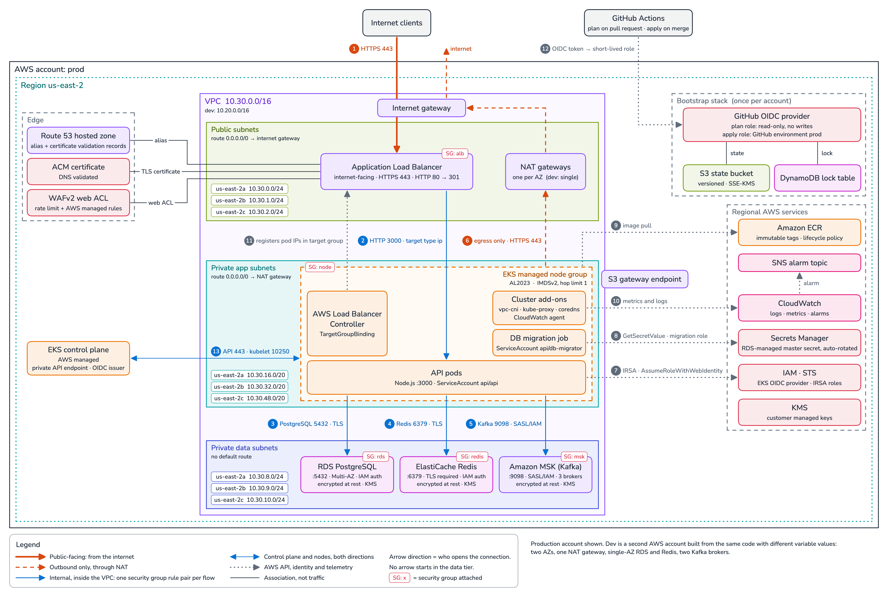

# Architecture

This document is the written plan behind [`diagram.png`](../diagram.png). It fixes the
network layout, the allowed traffic flows, the identity model and the Terraform state
strategy before any resource is written, so every later change can be checked against it.

## Workload

One stateless Node.js HTTP API, packaged as a container and run on Kubernetes. It:

- serves HTTPS traffic from the internet;
- reads and writes a PostgreSQL database;
- caches in Redis;
- publishes and consumes Kafka events.

Region: `us-east-2`. Two environments, `dev` and `prod`, each in its own AWS account and
built from the same code with different variable values.

## Diagram

The diagram shows the production topology; its outer frame is the production AWS
account. It is drawn tier-first: the three horizontal bands are the subnet tiers, which
are the security boundaries. Availability Zones are redundancy inside each tier. The
numbers on the arrows are the rows of the table below.

Two rules hold for every arrow:

- the arrow starts at the side that **opens** the connection;
- **no arrow starts in the data tier**.

Arrow 13 is the only one with two heads: the control plane and the nodes each open
connections to the other. A thin line without a head is an association, not traffic.
The `SG` tags show the five security groups this code creates. The EKS cluster group,
which is also attached to the nodes, is not drawn. The Route 53 hosted zone is drawn in
the edge group, but the zone itself is created by the bootstrap stack; the `edge` module
creates only the records in it.

### Traffic flows

| # | From → to | Protocol and port | Class | Enforced by |
|---|-----------|-------------------|-------|-------------|
| 1 | Internet clients → load balancer | HTTPS 443 (HTTP 80 answers 301) | Public | Load balancer security group, WAF web ACL, ACM certificate. The only internet ingress in the system |
| 2 | Load balancer → API pods | HTTP 3000, target type `ip` | Internal | Rule pair `alb` → `node` |
| 3 | API pods → PostgreSQL | TCP 5432 over TLS | Internal | Rule pair `node` → `rds`; `rds.force_ssl`; IAM database authentication |
| 4 | API pods → Redis | TCP 6379 over TLS | Internal | Rule pair `node` → `redis`; transit encryption required; IAM-authenticated user |
| 5 | API pods → Kafka | TCP 9098, SASL/IAM over TLS | Internal | Rule pair `node` → `msk`; IAM policy scoped to a topic prefix |
| 6 | Nodes → NAT gateway → internet gateway → internet | HTTPS 443 | Outbound only | Route tables: nothing routes inbound through NAT. The port describes the traffic; no rule filters it |
| 7 | API pods → STS | `AssumeRoleWithWebIdentity` | AWS API | IRSA trust policy with exact `aud` and `sub` |
| 8 | DB migration job → Secrets Manager | `GetSecretValue` | AWS API | IRSA role with read access to one secret ARN |
| 9 | Nodes → ECR | Image pull | AWS API | Node role; image layers travel through the S3 gateway endpoint |
| 10 | Cluster add-ons → CloudWatch → SNS | Metrics and logs in, alarm notifications out | AWS API | IRSA role for the agent; topic policy |
| 11 | Load balancer controller → load balancer target group | Elastic Load Balancing API: registers pod IPs | AWS API | IRSA role; write actions limited to one target group |
| 12 | GitHub Actions → GitHub OIDC provider → CI role | OIDC token for a short-lived role | AWS API | Role trust on the token's claims. Each account has a plan role that matches the `pull_request` subject, and one apply role that matches the `environment:<name>` subject of its own environment and the `ref` of its deploy branch |
| 13 | EKS control plane ↔ nodes | 443, kubelet 10250, admission webhooks | Control plane | Cluster security group managed by EKS, which allows all traffic between its members |

- Flows 7 to 11 leave the VPC over the path of flow 6. Image layers in flow 9 are the
  exception: they use the S3 gateway endpoint. Flow 12 never enters the VPC.
- The migration job reaches PostgreSQL over the same rule pair as flow 3. The diagram
  draws only the API's connection.
- A pull request from a branch of this repository can assume the plan role of each
  account, and it can also change the workflow it runs. That is why a plan role cannot
  write the state, the lock or any resource, and why it is denied secret values. A plan
  job must not name a GitHub environment: with one, its token carries the environment
  subject instead of `pull_request`.
- Pull requests from forks get no OIDC token: the plan workflow runs on the
  `pull_request` event, where a run from a fork has a read-only `GITHUB_TOKEN` and
  cannot request one. The one exception is a private repository that enables "Send
  write tokens to workflows from pull requests". That setting stays off.
- Which branch may deploy to an environment is enforced twice. The apply role's trust
  policy requires the token's `ref` to be the deploy branch: `develop` for dev, `main`
  for prod. The GitHub environment's protection rules repeat the branch and, for prod,
  add required reviewers. The IAM condition does not depend on how the environment is
  configured: any job can name an environment, and GitHub creates an environment that
  does not exist yet without any rule. It does depend on who can push to the deploy
  branch, so `develop` and `main` are protected and take changes through pull requests
  only.
- The trust policies match GitHub's immutable subject format, which carries the numeric
  IDs of the owner and of the repository next to their names:
  `repo:OWNER@OWNER-ID/REPO@REPO-ID:...`. It is the default for repositories created
  after 15 July 2026, and an older repository opts in. Matching that form exactly means
  a role cannot be assumed from a repository that later takes over the same name.

## Network plan

Availability Zones are passed explicitly as a variable, so plans never depend on looking
them up and the order can never reshuffle.

| | dev | prod |
|---|---|---|
| Availability Zones | `us-east-2a`, `us-east-2b` | `us-east-2a`, `us-east-2b`, `us-east-2c` |
| VPC CIDR | `10.20.0.0/16` | `10.30.0.0/16` |
| NAT gateways | One, shared | One per Availability Zone |
| PostgreSQL | Single-AZ instance | Multi-AZ instance |
| Redis | One node | Primary and replica in different zones, automatic failover |
| Kafka | 2 brokers, replication factor 2, `min.insync.replicas` 1 | 3 brokers, replication factor 3, `min.insync.replicas` 2 |

The third production zone exists for Kafka. Brokers come in multiples of the zone
count. With replication factor 3 over two zones, two replicas of a partition share a
zone, and losing that zone leaves one replica in sync, below `min.insync.replicas` 2,
so the partition stops accepting writes. Three zones keep two replicas in sync. Dev
runs two brokers with replication factor 2, which can lose acknowledged writes when a
broker fails. That trade-off is accepted for dev only.

Subnets are computed from the VPC CIDR and keyed by zone, so adding a zone appends
subnets and never renumbers existing ones.

| Tier | Holds | `us-east-2a` | `us-east-2b` | `us-east-2c` (prod) | Default route |
|------|-------|--------------|--------------|---------------------|---------------|
| Public | Load balancer, NAT gateways | `10.x.0.0/24` | `10.x.1.0/24` | `10.x.2.0/24` | Internet gateway |
| Private app | EKS nodes and pod IPs | `10.x.16.0/20` | `10.x.32.0/20` | `10.x.48.0/20` | NAT gateway |
| Private data | RDS, ElastiCache, MSK | `10.x.8.0/24` | `10.x.9.0/24` | `10.x.10.0/24` | None |

`x` is 20 in dev and 30 in prod.

- The app tier uses `/20` blocks because the VPC CNI gives every pod a VPC address.
- The data tier has no default route. Its resources cannot start a connection out of
  the VPC, which backs the security group rules at the routing layer.
- A NAT gateway is a zonal resource. Production uses one per zone so that losing a zone
  does not cut outbound access, which carries STS calls and image pulls, for the
  healthy zones. Dev accepts that risk to save cost.
- An S3 gateway endpoint is attached to the app route tables. It is free and keeps
  image layer downloads off the NAT gateway.
- VPC flow logs are delivered to a CloudWatch Logs group encrypted with a key of its
  own, whose policy lets CloudWatch Logs use it for that group only.
- The VPC's default security group is emptied of its rules. Nothing uses it, and a
  resource created without a group of its own then gets no access.

## Security groups

Every security group this code creates starts empty, and every rule is a separate
resource that references another security group, never a CIDR range. The only exception
among them is the load balancer, which must accept the internet. Each internal flow is
a rule pair: an egress rule on the caller and an ingress rule on the target, each
naming the other group.

| Security group | Ingress | Egress |
|----------------|---------|--------|
| `alb` | TCP 443 and 80 from `0.0.0.0/0` | TCP 3000 to `node` |
| `node` | TCP 3000 from `alb` | TCP 5432 to `rds`, 6379 to `redis`, 9098 to `msk` |
| `rds` | TCP 5432 from `node` | None |
| `redis` | TCP 6379 from `node` | None |
| `msk` | TCP 9098 from `node` | None |
| EKS cluster group, created by EKS and also attached to the nodes | All traffic from itself | All traffic to `0.0.0.0/0` |

The three data store groups have no egress rule at all, and no group accepts traffic
from a data store group. That is what makes the flows one-directional.

Two limits of this model, stated plainly:

- By choice, the nodes carry two groups: `node` and the cluster group in the last row.
  EKS keeps the control plane, DNS and node-to-node rules in that group, so none of
  them is hand-written here. The price is that a node's effective egress is
  unrestricted. The `node` egress rules document intent; what enforces each data flow
  is the ingress rule on the data store. Leaving the cluster group off the nodes and
  writing those rules by hand is the stricter alternative.
- With the default VPC CNI, a pod's traffic carries its node's security groups. At the
  network layer the data stores see "nodes of this node group", not "API pods".
  Pod-level least privilege is enforced one layer up, by identity.

## Identity and secrets

No secret is written in code, and none enters a plan or the state.

| Access | Mechanism |
|--------|-----------|
| PostgreSQL master user | Password generated, stored and rotated by RDS in Secrets Manager. Terraform only ever holds the secret's ARN |
| API → PostgreSQL | IAM database authentication as a non-privileged user |
| Master secret | Among the workloads, read access is granted to one role only, the migration job's. The plan role is denied it. The apply role administers its account and can read it: see [CI roles](#ci-roles) |
| API → Redis | IAM-authenticated ElastiCache user: short-lived tokens over TLS |
| API → Kafka | SASL/IAM, limited to a topic prefix |
| Pods → AWS APIs | IRSA: one role per Kubernetes service account, with exact `aud` and `sub` conditions |
| CI → AWS | GitHub OIDC, set up in each account: a plan role (read-only: no write to the state, the lock table or any resource Terraform manages, and no access to secret values) and one apply role for that account's environment (administrator of its account, minus the Deny statements listed under [CI roles](#ci-roles)) |

Any pod on the node group can open a TCP connection to a data store. Only a pod whose
IAM role was granted access can authenticate to one.

The migration job is a pod with its own service account. It reads the master secret,
applies schema changes and creates the API's database user with `GRANT rds_iam`.
Terraform never connects to the database. `rds_iam` is never granted to the master
user, because that would stop its managed password from working.

Nodes enforce IMDSv2 with a hop limit of 1, so only a pod on the host network can
reach its node's credentials. Every other pod depends on IRSA. One consequence: the
load balancer controller cannot read its region and VPC from instance metadata, so it
is given both as arguments.

### CI roles

The plan role is the one exposed to code that nobody has reviewed. It holds the AWS
managed `ReadOnlyAccess` policy and read access to the root state. It cannot write the
state, the lock table or any resource Terraform manages. Because it cannot take the
state lock, the pull request job runs `terraform plan -lock=false`. That plan is never
applied. One that overlaps an apply can fail on the state checksum, or succeed silently
against a state the apply has not finished writing. Explicit Deny statements remove what
`ReadOnlyAccess` must not be used for here: secret values, decryption with any key other
than the state key, and every S3 object other than the root state. What stays readable
is configuration, and data those statements do not reach: logs, container images and
parameters stored as plain text, for example.

The apply role holds the AWS managed `AdministratorAccess` policy. It has to create IAM
roles for the cluster and its workloads, and a principal that can create roles and
attach policies to them can grant itself anything. A list of allowed services would
therefore not make the role weaker. An administrator can also read every secret in its
account, the PostgreSQL master secret included. Three things limit the role instead:

- Its trust policy: one repository, one GitHub environment and one branch. The branch
  is only as closed as its protection. If it accepted direct pushes, anyone with write
  access could run the apply role without a pull request. A rule that only requires a
  pull request adds no second person: whoever may merge into the deploy branch can run
  that account's apply role. For prod the second person is the environment's required
  reviewer; dev has none.
- Its account: it holds one environment, and no role in the other account trusts it.
- Deny statements on the bootstrap resources: the role cannot change the CI roles or
  the OIDC provider, cannot administer the state bucket, the lock table or the state
  key, cannot read or write the bootstrap state, and cannot delete the hosted zone.

The Deny statements stop any such change that arrives as a change to the root module.
They do not stop someone who already controls an apply run, who can create a second
role without them. Closing that gap needs a permissions boundary on every role the
pipeline creates. It is left out until an account is shared with a second pipeline.

## Cluster access and workloads

The Kubernetes API endpoint is private. Terraform uses only the AWS API and never calls
Kubernetes, so the pipeline runs on GitHub-hosted runners with no network path to the
cluster. People and tools get access through EKS access entries for named IAM
principals. The identity that creates the cluster gets no implicit admin rights.

The load balancer controller, its `TargetGroupBinding`, the service accounts annotated
with their role ARNs and the workloads themselves are Kubernetes objects. They are
deployed from inside the VPC by a separate path that this repository does not
provision. Until the binding exists the target group is empty and the load balancer
answers 503.

## State and environments

Each environment runs in its own AWS account, and each account holds two Terraform
states:

| State | Contents | Backend |
|-------|----------|---------|
| `bootstrap/`, applied once per account | State bucket, lock table, state encryption key, GitHub OIDC provider, CI roles and the public hosted zone | Local for the first apply, then moved into the bucket it created, key `bootstrap/terraform.tfstate` |
| Root module | Everything else for the environment | The account's state bucket, key `platform/terraform.tfstate` |

- The accounts share no AWS resource. Each has its own state bucket, lock table,
  encryption key, OIDC provider, CI roles and hosted zone, and no role in one account
  trusts the other. They do share this repository, whose workflows can assume the CI
  roles of both. Every bootstrap resource exists twice; in return, an IAM policy that is
  too broad in dev grants no access to prod.
- Environments are data, not code. Each `environments/<env>/` directory holds three
  files: `terraform.tfvars` with the values of the root module, `bootstrap.tfvars` with
  the values of the bootstrap stack, and `backend.hcl`, which names the account's state
  bucket, lock table and encryption key. Each file has the same keys in dev and prod.
  All are committed and hold no secret.
- `backend.hcl` is read by both stacks, so it does not name the state object. Each
  stack writes its own key in its `backend` block. A key in the shared file would point
  both stacks at one object.
- Each environment's variable file names its AWS account ID, and the provider is
  restricted to that account with `allowed_account_ids`. A run that holds another
  account's credentials fails when the provider is configured, instead of changing the
  wrong account. The check is made by the provider. It does not cover the state backend,
  which takes its configuration from `backend.hcl`: the backend's own account check
  needs Terraform 1.6, above the oldest version this code supports. Separate accounts
  cover the gap, because credentials for one account cannot open the other account's
  bucket. The bootstrap stack takes its account ID as a variable and sets the same
  restriction.
- State locking uses a DynamoDB table. Terraform 1.11 and later print a deprecation
  warning for it on every init, plan and apply. It stays because its replacement,
  `use_lockfile`, is rejected by Terraform 1.5 to 1.9, and 1.5 is the oldest version
  this code supports.
- Terraform workspaces are not used. All workspaces of a configuration are stored in
  the same backend, so the dev and prod states would sit in one bucket in one account.
  The selected workspace is also local state that never appears in review.
- The public hosted zone is created by the bootstrap stack, not by the `edge` module,
  for two reasons. First, the parent domain must delegate to the zone with an NS record
  before ACM can validate a certificate through DNS, and that record is created outside
  this repository, because the parent domain is managed elsewhere. Second, the zone
  should outlive an environment: by default a recreated zone gets new name servers, and
  the delegation would have to be redone.
- The zone's name is a variable, for example `dev.example.com`. The root module finds
  the zone by that name and hands it to `edge`, which creates the certificate, its DNS
  validation records and the alias record for the load balancer. A new account is set
  up in this order: apply `bootstrap/`, delegate the zone from the parent domain, apply
  the root module.
- Each account has its own image repository, because `registry` is part of the root
  module. Copying a released image from the dev registry to the prod registry belongs to
  the pipeline that builds and deploys the service, which this repository does not
  provision.
- Splitting the root state by layer (network, cluster, data) is deferred. The modules
  are already cut along those boundaries, with narrow outputs and a one-directional
  dependency graph, so the split is mechanical when a second service or a second team
  makes the smaller blast radius worth the extra wiring.

## Modules

| Module | Purpose | Consumes |
|--------|---------|----------|
| `networking` | VPC, subnet tiers, internet and NAT gateways, routing, S3 endpoint, flow logs and their encryption key | Nothing |
| `security` | All security groups and every cross-layer rule | `networking` |
| `irsa-role` | Reusable role for one Kubernetes service account | An OIDC provider ARN and issuer URL |
| `compute` | EKS cluster, managed node group, cluster and node roles, OIDC provider, the `vpc-cni`, `kube-proxy`, `coredns` and CloudWatch agent add-ons, the keys for Kubernetes secrets and control plane logs | `networking`, `security`; calls `irsa-role` for the add-on roles |
| `data` | RDS PostgreSQL, ElastiCache Redis, their encryption keys and log groups, and the client policies of the API and the migration job | `networking`, `security` |
| `messaging` | MSK cluster, broker configuration, its keys and broker log group, and the API's Kafka policy | `networking`, `security` |
| `edge` | ACM certificate and its DNS validation records, load balancer, listeners, target group, Route 53 alias, WAF, WAF logs, and the load balancer controller's policy | `networking`, `security`, the account's public hosted zone, created by the bootstrap stack |
| `registry` | ECR repository, its encryption key and lifecycle policy | Nothing |
| `observability` | Encrypted alarm topic, and CloudWatch alarms on PostgreSQL, Redis, the EKS nodes, Kafka and the API | Outputs of the modules above |

The module that owns a resource publishes the smallest policy a client needs. The root
module binds those policies to a service account through `irsa-role`. Neither the
cluster nor the data layer depends on the other.

## Open points

Nothing in this repository is applied to an AWS account; the Terraform is validated
only. These statements in the plan rest on documentation or on the provider schema and
have not been confirmed against the AWS API. Each is settled, or kept as a documented
assumption, in the batch named.

| Point | Fallback | Batch |
|-------|----------|-------|
| A Redis OSS user group must contain a user named `default`. The plan replaces it with a disabled user that has no password | The Valkey engine, selected by one variable. Its user groups do not need that user | Data |
| The `msk` group has no egress rule and no rule to itself, on the assumption that traffic between brokers does not pass through it | Add a rule pair, `msk` to itself | Messaging |
| Node pressure alarms use Container Insights metrics, which may not be published under an IMDS hop limit of 1 | The node group's CPU alarm, which reads EC2's own metric and works without the agent, is already in place next to them | Observability |
| The controller's write actions are scoped to one target group. The policy has not been exercised by a running controller | Use the controller's published policy without the scoping | Edge |
| The token subject of `pull_request` and `environment` runs, in the form that carries the owner and repository IDs, is inferred from the documented example for a branch | Read the claims of a real token in the first pipeline run and correct the GitHub values of the bootstrap stack | CI pipeline |
| The pull request plan runs with `-lock=false` under a role that has no write permission. That `init` and such a plan write nothing rests on the S3 backend source of Terraform 1.5.7 and 1.15.1 and has not been exercised by a real run | Allow the plan role to write the lock item only, through a condition on the lock table's partition key. A pull request can then hold the lock, or release one an apply holds | CI pipeline |
| Moving the bootstrap state from the local file into the bucket follows the documented procedure and has not been run | Keep the local state file until a plan against the bucket reports no changes | Foundation |
| Required reviewers on the `prod` environment and protection of `develop` and `main` are assumed to be available. On a free GitHub plan both exist for public repositories only | The `ref` condition in IAM holds without either. Without required reviewers or a required approving review, anyone with write access can run an apply role, by a direct push or by merging their own pull request, so write access is then limited to the people trusted with both accounts | CI pipeline |

## Delivery roadmap

Work lands in batches, one per platform area. Each batch is a `feature/*` branch and
one pull request into `develop`. Releases group related batches.

| Release | Batches |
|---------|---------|
| `0.1.0` | Architecture diagram, written plan, contribution conventions |
| `0.2.0` | Terraform foundation (per-account bootstrap stack, root skeleton, quality gate); CI pipeline with OIDC |
| `0.3.0` | Networking and security groups; compute (EKS, IRSA, ECR) |
| `0.4.0` | Data layer (RDS, Redis); messaging (MSK) |
| `0.5.0` | Edge (load balancer, certificate, DNS records, WAF); observability (CloudWatch agent add-on, alarms) |
| `1.0.0` | Documentation, decision records, final review |
